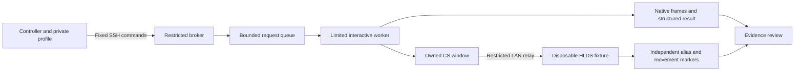

# Autonomous client acceptance lab

The lab runs the real Steam Counter-Strike 1.6 client on a dedicated second
Windows laptop and a disposable HLDS fixture on the controller laptop. Its
reusable source lives in `tools/client-lab`. Local machine configuration,
licensed game files, credentials, generated packages and raw evidence stay in
owner-controlled storage outside Git, or in the ignored `artifacts/` directory.



## Supported scope

- Protocol 2, runner revision 16, manual lease, Windows PowerShell 5.1 worker.
- Fixed client area 1920x1200; the current MOTD pixel profiles are tied to addon
  0.38.0 and reviewed RU/EN content. Different text, fonts, layout or
  dimensions require a new reviewed profile and real-client evidence.
- Autonomous `/rules`, `/ranks`, `/profile` and `/topall` interaction: capture, guarded OK, returned movement,
  reopening with the alternate alias, guarded final OK and returned movement.
  Five native frames are retained. A successful result remains
  `autonomous_captured_unreviewed` until evidence is assessed.
- Single-panel capture also supports `ranks`, `profile`, `topall`, `rules`,
  `primary` and `pistol`. This does not provide autonomous interaction coverage
  for the weapon-selection menus.
- The separate fixed weapons workflow adds four-frame `capture-guns` baseline
  setup and reviewed-profile-gated `auto-panel ... guns ...` interaction.
  See [the weapon-menu boundary](client-guns-acceptance.md); five main frames
  plus four checkpoints and independent inventory/respawn evidence are required.
- Only the test process and owned game window receive actions. Focus denial,
  a locked desktop, a competing game, changed process identity, unexpected
  pixels or expired/revoked authorization stop the attempt. There is no global
  keyboard/mouse fallback and no automatic retry after uncertain dispatch.

This is project test infrastructure. It does not belong in the public monitoring
API or the production game addon. PvP behavior, real player activity, 24-hour
aggregation and verification of the renderer remain separate acceptance gates.

The fixed `/profile` fixture uses a LAN identity with unavailable saved results
and zero connection/map counters. `/topall` uses exactly three synthetic stored
rows (Lab Alpha, Lab Bravo and Lab Charlie), including distinct ranks, kills and
deaths; the connected client's saved place is unavailable. No identity is forged
and no real player data is imported. These profiles do not cover arbitrary live
statistics. See [panel scope and verification](client-panel-acceptance.md).
All six additional MOTD panel/language cases passed native interaction acceptance
with 30 reviewed frames by 2026-11-01. Their capture-only baselines are separate
from that interaction proof. The weapons workflow has its own adoption gates.

## Provisioning contract

The repository prepares bundles; it does not install SSH, create accounts,
firewall rules, keys or scheduled tasks. Before using a bundle, separately
review and provision the target against the following contract:

1. Pin the controller/client private IPv4 pair, uppercase host identity, interactive user
   SID/session and game/Steam paths in a private profile based on
   `tools/client-lab/examples/profile.example.json`.
2. Use the limited `gso-lab-link` transport account on port 2222 with pinned host
   key and one fixed command handler. Disable arbitrary shell, forwarding and
   user-supplied file/command paths. The broker exposes only its parsed protocol;
   the separate updater gateway exposes status and framed signed staging.
3. Protect `C:\ProgramData\GsoClientLab\code`, policy and the nine-file hash
   manifest against writes by the transport and interactive accounts. Grant only
   the reviewed queue/result access. Run `GsoClientLab-Worker` in the exact
   limited interactive user session through the hidden fixed launcher. Preserve
   the worker task invariant and finite watchdog. The legacy expiry task stays
   disabled for a manual lease; stopping the runner must still be possible.
   `policy.example.json` describes the game/transport scope, not OS ownership.
   Preserve locally recorded service ownership and account SID fields in the
   installed policy; never replace that policy with the example file.
4. If signed updates are enabled, protect
   `C:\ProgramData\GsoClientLabUpdater` and its trust/configuration/state with
   administrator-only writes. Pin the signing public key, target, lease,
   predecessor hashes and task invariant. Signing private material remains
   DPAPI-protected under the controller user and is never transferred.
5. Independently record `activation.json` after installation. The generator
   checks its consistency with the profile; that check alone does not establish
   that installation, ACLs or task principals are trustworthy.
6. Authorize UDP 27025 only between the selected two laptops. No host Docker
   port is published. Existing SSH/firewall approval does not authorize a new
   address, key, account or broader access.

The controller expects its existing pairing, SSH config, pinned `known_hosts`
and key in `%USERPROFILE%\.ssh\gso-client-lab`. A bundle contains none of these.
Keep Steam logged in and free of another game session, the target awake and
unlocked, and CS closed before a run. The worker can attempt supported activation
of its own window, but cannot guarantee activation under every desktop policy.

## Local preparation

Controller prerequisites: Windows, PowerShell 7, Python 3.12, Docker Desktop in
Linux-container mode and a locally retained fixture image/assets. No preparation
command downloads games or authenticates to Steam. The target uses its already
installed licensed client. `New-LabRun.ps1` and `run_fixture.py.in` record the
exact accepted image, addon, dictionary, SDK and server-library hashes.

The cache contains the hash-pinned AMXX 1.10 build 5481 base/cstrike archives.
The runtime directory contains the reviewed ReHLDS, ReGameDLL, Metamod and ReAPI
trees. The local Docker image contains `/opt/cs16/serverfiles-base`, Python and
the `steam` user. Retain these prerequisites privately; they are not redistributed
by this repository. Use `Build-FixtureHelper.ps1` with the retained AMXX/ReAPI
cache and a fresh output file. It pins the Windows compiler/DLL and uses `-d0 -E`,
then requires the exact helper hash in `New-LabRun.ps1`. It never downloads a
toolchain. This source-built helper differs from the historical debug binary;
fresh EN/RU real-game validation passed during the 2026-10-31 adoption recorded
in [the readiness record](client-lab-readiness.md).

The following variables refer to private, operator-selected local paths:

```powershell
$tool = Join-Path (Get-Location) 'tools/client-lab'
& "$tool/Build-FixtureHelper.ps1" -CacheDirectory $toolchainCache -OutputPath $fixtureHelper
& "$tool/New-LabBundle.ps1" -ProfilePath $privateProfile -OutputDirectory $bundle
& "$tool/New-LabRun.ps1" -BundleDirectory $bundle -ActivationPath $activation `
    -AddonDirectory $acceptedInputs -HelperBinaryPath $fixtureHelper `
    -Language en -OutputDirectory $run
python -B "$tool/lab_fixture.py" plan --run-directory $run
```

`$acceptedInputs` contains `goldsrcops.amxx` and `goldsrcops.txt` with the pinned
accepted hashes. Preparation creates fresh output only, without installing the
bundle, connecting to the laptop or starting Docker/Steam/the game. Review the
generated hashes against the installed predecessor before any target update.

## One bounded run

After validating the prerequisites and authorized LAN access:

```powershell
python -B "$tool/lab_fixture.py" start --run-directory $run --execute
# Read evidence/runtime.json; proceed only when status=ready and runtimeVerified=true.
python -B "$tool/lab_fixture.py" relay --run-directory $run --execute
# Read relay-lan.json; proceed only when status=ready and the exact LAN pair matches.
$job = [guid]::NewGuid().ToString('D')
& "$run/Invoke-Panel.ps1" -Operation status
& "$run/Invoke-Panel.ps1" -Operation auto-rules -JobId $job -Language en
& "$run/Collect-Autonomous.ps1" -JobId $job
# Stop the fixture in a finally block, including after any failure.
python -B "$tool/lab_fixture.py" stop --run-directory $run --execute
```

For one of the other fixed MOTD panels, use `-Operation auto-panel -Panel ranks`
(or `profile`/`topall`) with the same language/job parameters. The controller
checks the installed capability before dispatch. The fixed protocol rejects all
other panels, extra text and manual step acknowledgements for autonomous jobs.
Each panel/language pair needs its own fresh fixture, request and reviewed result.

Use a fresh run directory and job ID for the other language. Start/relay/dispatch
claims are retained permanently. A timeout is an uncertain attempt: query its
existing ID, collect any result and reconcile cleanup. Do not clear claims or
submit the same action under a fresh ID to bypass a failure. Fixture startup
failure may leave its recorded internal network/container; cleanup verifies
their exact IDs, names, image and labels before removal. An interrupted cleanup
requires inspection of the recorded resources before a further mutation.

The relay expires after 25 minutes and the fixture has a 40-minute process
bound. The worker watchdog and collector deadline are finite. These guards do
not replace explicit cleanup or establish that the remote process stopped when
the read channel is lost. Stop the fixture even if client collection fails;
confirm target cleanup independently through result/status before a new run.

## Evidence and acceptance

Use [the campaign controller](client-controller.md) for a persisted six-case
matrix, Steam hold and same-ID reconciliation over these existing primitives.
Its [offline readiness and pending live gate](client-controller-readiness.md)
are tracked separately from installation and real-client acceptance.

Review all five frames, their byte lengths/hashes, job identity/language and
ordered interaction result. Require `fixtureEvidenceComplete=true` in cleanup,
actual boolean `cleanupVerified` and
`configCleanupVerified`, confirmed final game-process absence, restored owned
configuration, fixture removal and stopped relay. Review the bounded final
server log for both rules aliases, cooldown and movement markers. The helper
observes both input buttons and actual movement distance; it does not simulate
movement or close the rules panel. Require zero fixture AMXX error files in
`evidence/amxx-errors.json`. Missing evidence remains an incomplete gate.

The collector intentionally writes `acceptancePassed=false`: complete transport
does not equal client acceptance. CI uses synthetic frames and mocked providers;
it cannot prove real rendered panel recognition, focus behavior, Steam readiness
or the new generated bundle's deployment. Retain raw evidence privately and put
only a sanitized result/identity summary in milestone documentation.

## Updates, queue maintenance and rollback

The updater accepts exactly nine runner filenames. Only five may change by a
signed package; `Lab.Common.ps1`, `Expire.ps1`, `Uninstall.ps1` and
`Worker-Quiet.js` are pinned. A local-profile change that changes pinned files,
or a change to privileged updater code, requires a separately reviewed local
administrator bootstrap. The updater cannot replace its own trust engine.
The existing lab completed this local engine adoption and a signed runner update
on 2026-10-31. Future trust-engine or pinned-file changes still require their own
reviewed local administrator migration; ordinary permitted runner updates use
the existing signed channel without a local installer.

For routine updates use generated `Invoke-FramedUpdate.ps1 -Operation status`,
save the predecessor state privately, then use `New-UpdatePackage.ps1` with
`-SigningKeyDirectory`, `-CodeDirectory`, `-PredecessorState`, `-Revision` and a
fresh `-OutputPath`. Review the package identity before staging it once with
`Invoke-FramedUpdate.ps1 -Operation stage -Id ... -PackagePath ...`. Query the
same ID and independently verify installed hashes/task state. A signed package
expires after 24 hours. Signing and staging do not authorize a new permission.

The active queue allows eight requests and the archive 128. Status lists exact
completed request IDs/hashes. `New-ArchivePlan.ps1 -InventoryPath ...
-ResultDirectory ... -Id ... -OutputPath ...` creates an advisory plan for at
most eight jobs. Pass it as `-ArchivePlan` when signing maintenance. The engine
rechecks identity, cleanup, terminal status, worker idleness and request hashes.
It moves requests only; results/images remain and acceptance status is unchanged.
The repository engine adds both interaction/autonomous unreviewed terminal
states and strict cleanup booleans. The adopted lab has exercised this support
with one completed autonomous request while preserving its result and image.
Other existing installations require local engine adoption before relying on it.

Partial update failures restore recorded code, hash manifest, sequence, requests
and worker budget. Uncertain rollback leaves the worker disabled and the claim
retained for local reconciliation. Never replace keys, relax pins or erase
evidence to force a retry. Use the recorded known-good predecessor only inside
the same reviewed target, policy and task boundary.
